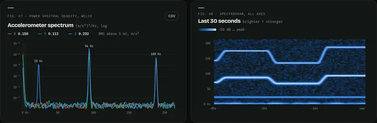
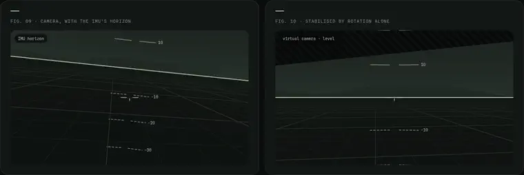
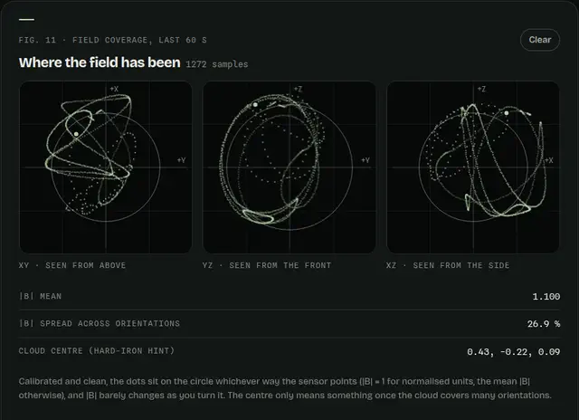
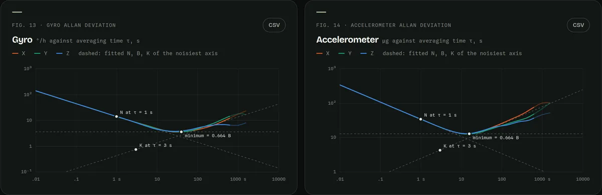
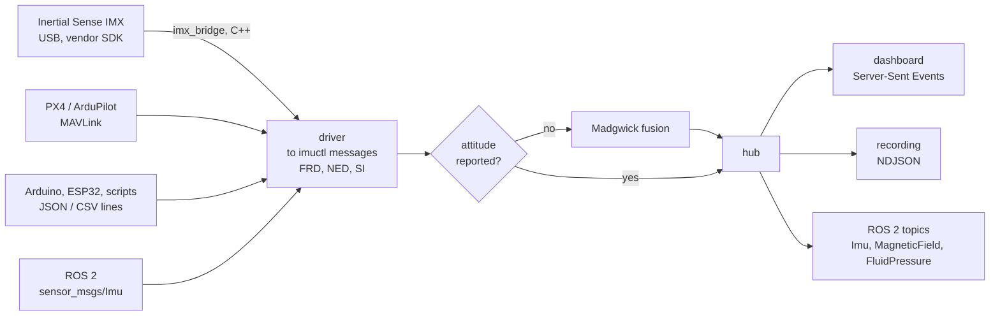

<div align="center">

# Universal IMU Control Dashboard

**Plug in any IMU and see it think.** One small server turns an Inertial Sense IMX, a PX4 or ArduPilot flight
controller, an Arduino with an MPU-6050, or any ROS 2 IMU topic into the same live 3D dashboard, a replayable
recording, or standard ROS 2 topics.

[](https://github.com/Kronbii/universal-imu-control-dashboard/actions/workflows/ci.yml)
[](https://kronbii.github.io/universal-imu-control-dashboard/)


<sub>The dashboard, recorded frame by frame from its built-in simulator. <a href="https://kronbii.github.io/universal-imu-control-dashboard/">Open the live demo</a>: it runs in your browser, no hardware or install, every panel live.</sub>

</div>

## What you get

<table>
<tr>
<td width="50%" valign="top">

**The sensor, in 3D.** The device turns in real time by its own attitude quaternion, modelled as what it is: a
RUG-3 enclosure drawn from its datasheet, a quadrotor for flight controllers, a breakout board for everything else.
Leader-line callouts carry live body rates; a chase camera keeps every axis in view.

</td>
<td width="50%"></td>
</tr>
<tr>
<td width="50%"></td>
<td width="50%" valign="top">

**The raw signals.** Tilt, angular rate, specific force and magnetic field as live strip charts, with a crosshair
that reads every axis at one instant, 5 to 60 s windows, pause, and CSV export of what's on screen.

</td>
</tr>
<tr>
<td width="50%" valign="top">

**Unplug it, plug it back.** The server follows a USB sensor across replugs, whatever `/dev/ttyACM*` it comes back
as, detects the unplug within a quarter of a second, and picks the stream back up on its own.

</td>
<td width="50%"></td>
</tr>
<tr>
<td width="50%"></td>
<td width="50%" valign="top">

**Any sensor that can print a line.** JSON or CSV over serial, UDP, TCP or stdin, in any units and axis order.
A sensor that only reports gyro and accelerometer gets its attitude from a built-in Madgwick filter.

</td>
</tr>
</table>

### Analysis, not just plots

<table>
<tr>
<td width="50%" valign="top">

**Where the vibration lives.** Welch spectra of every axis, the strongest peaks with their rpm, and a 30-second
spectrogram that shows a motor tone stepping with throttle. Pick notch-filter centres, find the frame resonance,
see what will blur a camera or upset an estimator.

</td>
<td width="50%"></td>
</tr>
<tr>
<td width="50%"></td>
<td width="50%" valign="top">

**A camera on the IMU.** From the attitude, the mount and a time offset, the IMU predicts where the true horizon
lands in each frame, and a rotation-only warp holds the view level: electronic stabilisation. Trim until the line
sits on the horizon through fast motion and you have the camera–IMU rotation and time offset, exported in Kalibr's
layout. Synthetic camera or your webcam; frames never leave the page.

</td>
</tr>
<tr>
<td width="50%" valign="top">

**Magnetometer calibration, done here.** Turn the sensor through every orientation, fit an ellipsoid, and watch
the distorted cloud close onto a sphere: hard and soft iron, with the |B| spread before and after as the check.
Apply it to the stream (before fusion, recording and ROS 2), keep it across restarts with `--magcal`, or take a C
header to your firmware.

</td>
<td width="50%"></td>
</tr>
<tr>
<td width="50%"></td>
<td width="50%" valign="top">

**Noise Lab.** Leave the sensor still and record. The Allan deviation splits its noise into white noise, bias
instability and bias random walk for every axis (IEEE 952), and the capture ends in a Kalibr `imu.yaml`: the noise
numbers a visual-inertial estimator needs, measured on your unit instead of copied from a datasheet.

</td>
</tr>
</table>

Also: barometric height (zero it, enter your QNH, watch the noise live), health decoded from each device's status
words, the device's identity, configuration and capabilities, record and replay, and a ROS 2 publisher.

<table>
<tr>
<td width="33%"></td>
<td width="33%"></td>
<td width="33%"></td>
</tr>
<tr>
<td align="center"><sub>Health, decoded</sub></td>
<td align="center"><sub>Magnetometer coverage</sub></td>
<td align="center"><sub>The device</sub></td>
</tr>
</table>

## From the bench to a camera–IMU system

The analysis panels follow the order an integration needs, and each one ends in something a robot can use:

1. **Vibration.** Mount the IMU where it will run and run the machine. Peaks near the camera's exposure time or
   the estimator's rate need isolation or a notch before anything else is worth tuning.
2. **Noise Lab.** On a still bench, record 15 minutes or more. The `imu.yaml` holds the measured noise densities
   and random walks that Kalibr, OpenVINS, VINS-Fusion and ORB-SLAM3 ask for.
3. **Camera.** Hold camera and IMU rigidly together, trim the overlay onto a real horizon, and raise the time
   offset until it stops lagging. The `camchain-imucam.yaml` is a starting rotation and time shift for Kalibr's
   camera–IMU calibration, or enough on its own for horizon overlays and stabilisation.
4. **Magnetometer.** In the installed position, tumble, fit and apply, so heading has a north.

## Supported sensors

| Driver | Devices | Link | Attitude from | Tested with |
|---|---|---|---|---|
| `imx` | Inertial Sense IMX-5 / IMX-6: RUG-3, RUG-4, bare modules | USB, serial (vendor SDK) | the device's EKF | RUG-3-IMX-5, firmware 2.7.0, on hardware |
| `mavlink` | PX4, ArduPilot, and other MAVLink autopilots | UDP, TCP, serial | the autopilot's estimator | PX4 1.18 SITL (SIH quadrotor) |
| `lines` | Arduino / ESP32 with MPU-6050, BNO055, ICM-20948, ...; phone apps; scripts | serial, UDP, TCP, stdin | the sensor, or fused here | synthetic CSV and JSON streams |
| `ros2` | any `sensor_msgs/Imu` topic | ROS 2 | the message, or fused here | ROS 2 Jazzy, round trip |
| `sim` | synthetic motion: IMX, AHRS or raw-IMU flavours | — | the simulator, or fused here | — |
| `replay` | any recording | file | as recorded | — |

Adding a sensor means writing one driver that emits [a handful of plain JSON messages](docs/protocol.md).

## Quick start

```bash
git clone --recursive https://github.com/Kronbii/universal-imu-control-dashboard.git && cd universal-imu-control-dashboard
./scripts/setup.sh                 # vendor SDK, C++ bridge, dashboard (Node 20+ for the dashboard build)

./imuctl sim                    # no hardware: open http://127.0.0.1:8765
./imuctl imx                    # an Inertial Sense unit on USB, found automatically
./imuctl mavlink                # PX4 / ArduPilot on UDP 14550 (pip install pymavlink)
./imuctl lines /dev/ttyUSB0@115200 --gyro-unit dps --acc-unit g --name MPU-6050
./imuctl ros2 --topic /imu/data # after sourcing ROS 2
```

Every driver takes the same extras: `--record run.ndjson`, `--fusion on|off|auto`, `--ros2-publish`, `--magcal cal.json`,
`--host 0.0.0.0`, `--no-web`. `./imuctl <driver> -h` lists the rest. Only the dashboard build needs Node; the server is Python 3.8+
with no dependencies (pymavlink for MAVLink, a sourced ROS 2 for ROS 2).

## How it fits together



Every source becomes the same messages: `device`, `att`, `imu`, `mag`, `baro`, `status`, `link`, in SI units with
an FRD body and a NED world (the conventions of aerospace and PX4). The Inertial Sense driver runs the vendor
SDK in a small C++ bridge and keeps the device's own data alongside, so its panels can decode every status bit.
[docs/protocol.md](docs/protocol.md) has the full format.

## Fusion

Sensors that report only gyro and accelerometer get attitude from a 6-axis Madgwick filter, plus a slow
tilt-compensated heading loop when a magnetometer is present. The heading loop is kept apart from tilt, so a
badly calibrated magnetometer can only ever disturb yaw.

On synthetic hand-held motion with a 0.17 °/s gyro bias and sensor noise (the test suite), the filter holds tilt to
**0.06° mean, 0.22° worst**, and heading to **0.5°** with a magnetometer. Without one, heading is relative and
drifts, and the dashboard says so.

## ROS 2

```bash
./imuctl imx --ros2-publish        # /imu/data, /imu/mag, /imu/pressure, frame imu_link
./imuctl ros2 --topic /camera/imu  # and the other way: any Imu topic into the dashboard
```

ROS uses FLU/ENU (REP-103); imuctl converts at that boundary and nowhere else. Publishing and then subscribing
to the same topic returns the original attitude to within 0.001°.

## Inertial Sense IMX-5

The project started on a RUG-3-IMX-5, and that support goes deepest:

- The vendor **SDK 2.7.1** is a submodule in `sdk/`, with `tools/cltool` (command line) and `tools/evaltool`
  (the vendor GUI, fetched on first run) ready to use.
- The `imx` driver finds the unit on USB itself, survives replugs, refuses ports that don't speak the vendor's ISB
  protocol (Betaflight boards share the USB IDs), and can stream the raw IMU at 1 kHz (`--raw-mult 1`).
- The dashboard decodes every bit of the unit's status words, its flash configuration and its EKF's bias
  estimates, and can start a magnetometer recalibration.
- [docs/inertial-sense-imx5.md](docs/inertial-sense-imx5.md) is an integration guide: outputs and rates, accuracy, a
  noise model for camera–IMU calibration, frames and the IMU's position in the case, timing and camera sync, pinout.

## On an NVIDIA Jetson

Everything runs on a Jetson. `./scripts/setup.sh --udev` builds the SDK and bridge with the distro `cmake` and
adds a `/dev/imx5` link. Build the dashboard on any machine and copy `web/dist/` across if the Jetson has no Node.
`--host 0.0.0.0` lets a laptop watch a headless Jetson; `--ros2-publish` hands the stream to the rest of the robot.

## Project layout

```
src/imuctl/ the server: drivers, protocol, fusion, hub, HTTP, ROS 2       imuctl      launcher, no install needed
bridge/     C++ bridge on the Inertial Sense SDK                          sdk/        Inertial Sense SDK 2.7.1 (submodule)
web/        the dashboard (React, three.js, WebGL), its maths, the demo   tools/      cltool and EvalTool launchers
docs/       protocol, IMX-5 guide, media                                   examples/   Arduino MPU-6050 sketch, UDP sender
tests/      protocol, fusion, parsing, IMX and MAVLink decoding           scripts/    setup, udev rule
```

## Development

```bash
python3 -m unittest discover -s tests   # 20 tests: maths, fusion accuracy, parsers, IMX and MAVLink decoding
cd web && npm test                      # 12 tests: spectra, Allan deviation, ellipsoid fit, camera geometry
cd web && npm run dev                   # dashboard with hot reload on :5173, against a running ./imuctl
```

CI runs the Python tests on 3.8 and 3.12 and the dashboard's maths tests, builds the dashboard, and compiles the
SDK and bridge. Every push to
`main` redeploys the [live demo](https://kronbii.github.io/universal-imu-control-dashboard/).

The dashboard's look follows [ramikronbi.com](https://ramikronbi.com). MIT licensed; the Inertial Sense SDK is MIT
under its own copyright.
